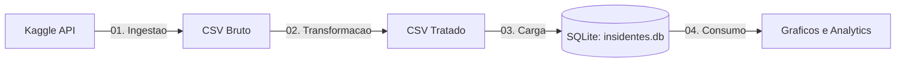

# Pipeline de Engenharia de Dados & DataOps: Análise Global de Cibersegurança

<p align="center">
  <b>Universidade de Fortaleza (UNIFOR)</b><br>
  Pós-Graduação em Engenharia de Dados<br>
  Projeto Prático de DataOps & Pipeline de Dados
</p>

---

## 📌 1. Visão Geral do Projeto

Este repositório contém o projeto prático desenvolvido como parte da **Pós-Graduação em Engenharia de Dados da Universidade de Fortaleza (UNIFOR)**.

O objetivo do projeto é implementar um **pipeline de dados automatizado e modular (ETL/ELT)** aplicando os princípios de **DataOps** (automação, rastreabilidade, reprodutibilidade e modularidade de ponta a ponta).

O pipeline consome dados públicos sobre incidentes globais de segurança cibernética (período de 2015 a 2024), realiza a ingestão automatizada via API, trata e padroniza as variáveis de interesse, persiste as informações em um banco de dados relacional e gera visualizações analíticas para suporte à tomada de decisão.

---

## 🏗️ 2. Arquitetura da Pipeline

O fluxo de dados foi desenhado seguindo a separação de responsabilidades em 4 estágios principais:



---

## ⚙️ 3. Etapas do Pipeline

O pipeline é orquestrado através do script raiz [`run_pipeline.py`](file:///d:/Meus%20Projetos/dataops/run_pipeline.py) e é composto pelas seguintes etapas modulares dentro de [`scripts/`](file:///d:/Meus%20Projetos/dataops/scripts):

| Etapa | Script | Descrição |
| :--- | :--- | :--- |
| **1. Ingestão** | [`01_ingestao.py`](file:///d:/Meus%20Projetos/dataops/scripts/01_ingestao.py) | Conecta e autentica na **Kaggle API**, realiza o download do dataset oficial `atharvasoundankar/global-cybersecurity-threats-2015-2024` e extrai o arquivo `.csv` bruto na pasta `data/`. |
| **2. Transformação** | [`02_transformacao.py`](file:///d:/Meus%20Projetos/dataops/scripts/02_transformacao.py) | Carrega o dataset bruto, seleciona colunas de maior valor analítico, normaliza os tipos de dados, traduz os atributos para o português e salva o arquivo tratado em `data/dados_transformados.csv`. |
| **3. Carga** | [`03_carga.py`](file:///d:/Meus%20Projetos/dataops/scripts/03_carga.py) | Lê os dados transformados e realiza a carga em um banco relacional **SQLite** (`data/insidentes.db`), criando e populando a tabela estruturada `insidentes`. |
| **4. Consumo** | [`04_consumo.py`](file:///d:/Meus%20Projetos/dataops/scripts/04_consumo.py) | Conecta ao banco de dados SQLite, executa queries agregadas em SQL para consolidar a quantidade de incidentes por país e plota gráficos analíticos com a biblioteca **Matplotlib**. |

---

## 📂 4. Estrutura do Repositório

```text
dataops/
│
├── data/                                      # Camada de armazenamento local de dados
│   ├── Global_Cybersecurity_Threats_2015-2024.csv # Dados brutos (Raw Data)
│   ├── dados_transformados.csv                # Dados tratados e traduzidos (Processed Data)
│   └── insidentes.db                          # Banco de dados relacional SQLite
│
├── scripts/                                   # Scripts modulares do pipeline
│   ├── 01_ingestao.py                         # Módulo de extração e ingestão (Kaggle API)
│   ├── 02_transformacao.py                    # Módulo de limpeza, seleção e tradução (Pandas)
│   ├── 03_carga.py                            # Módulo de persistência em banco relacional
│   ├── 04_consumo.py                          # Módulo de consulta SQL e visualização gráfica
│   └── kaggle.json                            # Arquivo de configuração de credenciais Kaggle
│
├── run_pipeline.py                            # Orquestrador sequencial ponta a ponta
├── requirements.txt                           # Dependências e bibliotecas do projeto
└── README.md                                  # Documentação técnica do projeto
```

---

## 🛠️ 5. Tecnologias & Ferramentas

- **Linguagem Principal:** Python 3
- **Manipulação & Engenharia de Dados:** [Pandas](https://pandas.pydata.org/)
- **Armazenamento Relacional:** [SQLite3](https://www.sqlite.org/)
- **Visualização de Dados:** [Matplotlib](https://matplotlib.org/)
- **Coleta de Dados:** [Kaggle API](https://github.com/Kaggle/kaggle-api)
- **Orquestração de Processos:** Subprocess (Python Standard Library)

---

## 🚀 6. Como Configurar e Executar

### Pré-requisitos
- Python 3.9+ instalado
- Gerenciador de pacotes `pip`
- Conta no [Kaggle](https://www.kaggle.com/) com chave de API gerada (`kaggle.json`)

### Passo 1: Clonar o Repositório
```bash
git clone https://github.com/seu-usuario/dataops.git
cd dataops
```

### Passo 2: Criar e Ativar Ambiente Virtual (Recomendado)
```bash
# Windows
python -m venv .venv
.venv\Scripts\activate

# Linux / MacOS
python3 -m venv .venv
source .venv/bin/activate
```

### Passo 3: Instalar as Dependências
```bash
pip install -r requirements.txt
```

### Passo 4: Configurar Credenciais do Kaggle
1. Acesse sua conta no Kaggle em **Account** -> **API** -> **Create New API Token**.
2. Um arquivo chamado `kaggle.json` será baixado.
3. Configure as credenciais no script [`scripts/01_ingestao.py`](file:///d:/Meus%20Projetos/dataops/scripts/01_ingestao.py) ou posicione o arquivo em:
   - **Windows:** `C:\Users\<Usuario>\.kaggle\kaggle.json`
   - **Linux/Mac:** `~/.kaggle/kaggle.json`

### Passo 5: Executar o Pipeline Completo
Para executar todas as etapas sequencialmente (Ingestão -> Transformação -> Carga -> Consumo), execute:

```bash
python run_pipeline.py
```

> **Dica:** É possível executar cada etapa individualmente chamando diretamente o script desejado, por exemplo:
> ```bash
> python scripts/02_transformacao.py
> ```

---

## 📊 7. Esquema dos Dados

Após a transformação, a tabela final `insidentes` no SQLite possui a seguinte estrutura de atributos:

| Campo | Tipo | Descrição |
| :--- | :--- | :--- |
| `pais` | TEXT | País onde ocorreu ou foi registrado o incidente |
| `ano` | INTEGER | Ano de ocorrência (2015 a 2024) |
| `tipo_ataque` | TEXT | Categoria do ataque cibernético (e.g., Ransomware, Phishing, DDoS) |
| `industria_alvo` | TEXT | Setor ou indústria atingida (Saúde, Finanças, Governo, etc.) |
| `perda_financeira_milhoes_usd` | REAL | Estimativa de prejuízo financeiro (em milhões de dólares) |
| `usuarios_afetados` | INTEGER | Volume estimado de usuários impactados |
| `origem_ataque` | TEXT | Origem identificada da ameaça |
| `tipo_vulnerabilidade` | TEXT | Falha de segurança explorada no incidente |
| `mecanismo_defesa` | TEXT | Ferramenta ou política de segurança empregada para mitigação |
| `tempo_resolucao_horas` | REAL | Tempo total para resolução e contenção do incidente (em horas) |

---

## 📈 8. Boas Práticas de DataOps Aplicadas

1. **Reprodutibilidade:** Qualquer membro do time ou avaliador pode reproduzir o pipeline na íntegra a partir de uma única linha de comando.
2. **Modularidade:** Cada estágio (ingestão, tratamento, banco, consumo) opera de maneira desacoplada, facilitando testes unitários e manutenções.
3. **Fail-Fast:** O orquestrador valida cada etapa com verificação de saída (`check=True`), interrompendo a cadeia caso algum erro seja detectado antes de avançar para as etapas posteriores.
4. **Camadas de Armazenamento:** Separação entre dado bruto (`Raw Data`), dado tratado (`Processed Data`) e camada servida (`Data Mart / SQLite`).

---

## 👨‍💻 Autor

- **Curso:** Pós-Graduação em Engenharia de Dados
- **Instituição:** Universidade de Fortaleza (UNIFOR)

